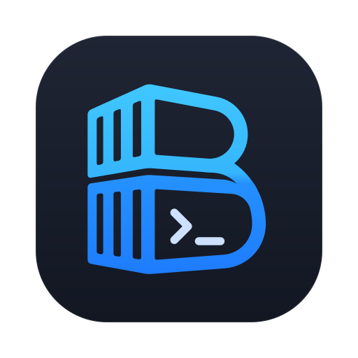

<p align="center">
  
</p>

<h1 align="center">Berth</h1>

<p align="center">
  A native Docker Desktop alternative written in Rust and GPUI
</p>

<p align="center">
  <a href="https://github.com/AleksanderEvensen/berth/actions/workflows/ci.yml"></a>
  <a href="https://github.com/AleksanderEvensen/berth/releases/latest"></a>
  <a href="LICENSE"></a>
  
  <a href="https://www.gpui.rs"></a>
  <a href="https://www.docker.com"></a>
  
</p>

## Development commands

Install [just](https://just.systems/) and run `just` to list the available actions.
Rust commands can still be run directly without just.

```sh
just setup                # fetch locked dependencies
just run                  # run the desktop app
just build                # development build
just release              # release build
just fmt                  # format the workspace
just check                # check all targets without linking
just lint                 # Clippy, with warnings treated as errors
just test                 # workspace tests
just test -p berth-docker # tests for one crate
just test-docker          # ignored integration tests; requires Docker
just verify               # formatting check - check - lint - tests
just ci                   # reproduce CI, including its build step
just package              # release packages into target/packager
```

## Run

```sh
just run
# Or: cargo run --locked -p berth
```

Linux needs the usual gpui system libraries (Wayland/X11, xkbcommon, fontconfig,
Vulkan driver). `ctrl+b` toggles the sidebar, `ctrl+q` quits, and `ctrl+/`
lists every shortcut (Settings - Shortcuts).


## Layout

```
apps/berth      the app: window chrome, shell, screens
crates/ui       design system: theme tokens, Geist fonts, Solar icons, components
crates/docker   engine domain model, container grouping, fixtures
docs            user stories, requirements, roadmap
```

## Credits

- [Geist](https://vercel.com/font) fonts - SIL OFL 1.1.
- [Solar Icons](https://www.figma.com/community/file/1166831539721848736) by 480 Design - CC BY 4.0.
